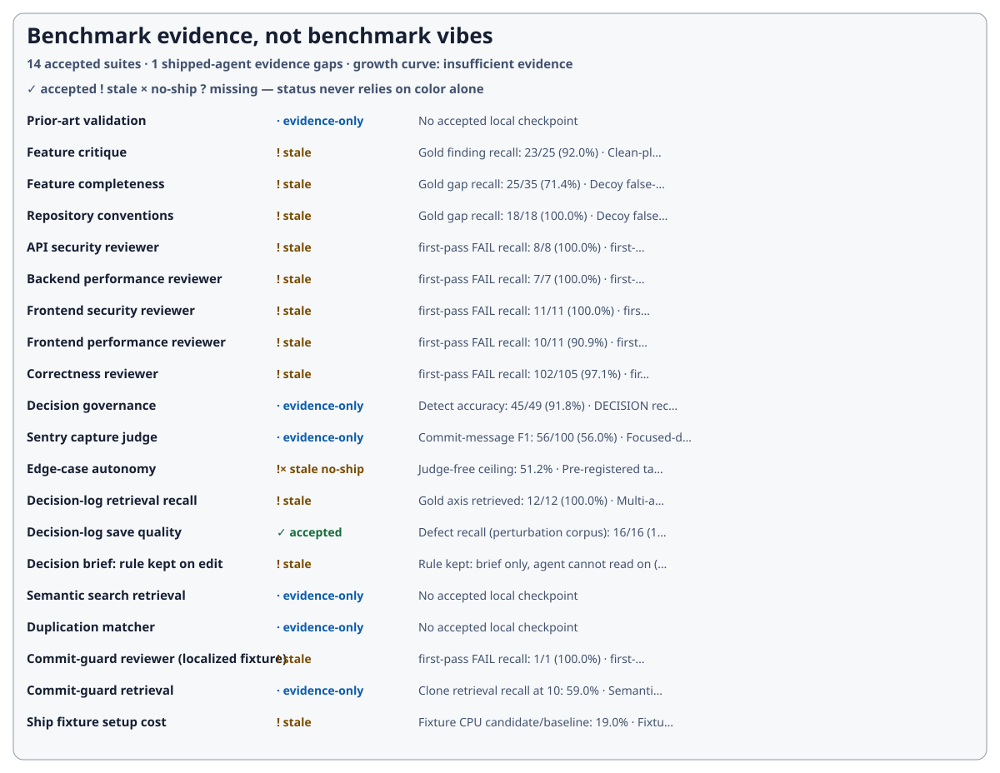

<h1 align="center">devkit</h1>

<p align="center">
  <a href="https://github.com/norvalbv/devkit"></a>
  <a href="https://github.com/norvalbv/devkit/tags"></a>
  
  
</p>

<p align="center">
  <strong>Guardrails for repositories where AI agents write the code.</strong><br/>
  Skills that tell your agents how the repo works, and commit-time gates that check they listened.
</p>

<p align="center">
  devkit installs agent skills, reviewer agents and a pre-commit gate chain from one versioned release, so the instructions and the checks never drift apart.<br/>
  It runs in your own git hooks. Model-backed reviewers use the Claude Code or Codex CLI you already have signed in.
</p>

<h3 align="center"><a href="#quick-start"><ins>Get started in three commands</ins></a></h3>

## Features

<table>
<tr>
<td width="50%" valign="top">

### Every commit gets checked

The pre-commit hook runs the cheap, deterministic checks first: whitespace, file-size and folder fan-out ratchets, project structure rules and long comment blocks. Then it looks for duplication, both verbatim copy-paste and near-duplicates found by semantic search. Ratchets freeze today's numbers, so existing debt doesn't block you and new debt can't get in.

[Gates →](skills/commit-gates/SKILL.md)

</td>
<td width="50%" valign="top">

### Reviewer agents read the diff

Opt-in reviewers for security, performance, correctness and your repo's own conventions judge the staged diff and block the commit with a specific finding. The conventions reviewer only speaks up when it can quote both the rule in your `CLAUDE.md` and the line that breaks it.

[Agents →](agents/)

</td>
</tr>
<tr>
<td width="50%" valign="top">

### Decisions your agents don't forget

Record why an architectural choice was made, once, under `docs/decisions/`. Before an agent edits a file, it is briefed on the rulings that govern that file. A commit that goes against one is flagged. Records are append-only and written through a CLI.

[Decisions →](skills/decisions/SKILL.md)

</td>
<td width="50%" valign="top">

### One release for skills and gates

Skills for security, performance, testing, correctness and more, plus the reviewer agents, sync to Claude Code, Codex and Cursor from the same tag as the gate engine. `devkit doctor` tells you when a copy has drifted, and `devkit upgrade` puts it back.

[Skills →](skills/)

</td>
</tr>
<tr>
<td width="50%" valign="top">

### Ship without moving your checkout

`devkit ship` commits the files you name onto a new branch in a throwaway worktree, runs the full gate chain and opens a PR. Your `HEAD` never moves, so agents sharing the same checkout aren't disturbed. `devkit review` runs the same chain without committing.

[Using devkit →](skills/using-devkit/SKILL.md)

</td>
<td width="50%" valign="top">

### Anti-slop lint you can adopt today

Pinned Oxlint and Oxfmt, plus 15 vendored rules and 3 devkit extensions that reject low-evidence TypeScript: chained type assertions, `unknown` returns, module mocking and more. A shrink-only baseline records what's already there, so you fix it over time instead of all at once.

[Anti-slop →](docs/anti-slop.md)

</td>
</tr>
</table>

**Also in the box:**

- **[Three install modes](#pick-a-mode)** — a normal dev dependency, a global CLI for shared repos, or an invisible overlay for repos you can't change.
- **Housekeeping commands** — `doctor`, `upgrade`, `move` (rename files and rewrite imports), `reconcile` and `clean`.
- **Optional gates** — flag swallowed runtime errors that lack a Sentry capture, enforce a coverage floor, or remind agents to attach screenshots for UI changes.
- **Shared TypeScript config** — `{ "extends": "@norvalbv/devkit/tsconfig/base" }`.
- **[Benchmarked agents](#benchmarks)** — reviewer agents are scored against labelled corpora. Gaps and stale scores are shown, not hidden.

---

## Supported agents

<p>
  <a href="https://code.claude.com/docs"><kbd> Claude Code</kbd></a> &nbsp;
  <a href="https://github.com/openai/codex"><kbd> Codex</kbd></a> &nbsp;
  <a href="https://cursor.com"><kbd> Cursor</kbd></a>
</p>

A fresh install sets up all three. Pass `--no-claude`, `--no-codex` or `--no-cursor` to leave one out.

---

## Quick start

You need Git, [Bun](https://bun.sh/) and Node.js 23.6 or newer. In the repository you want to guard:

```bash
bun add -D git+https://github.com/norvalbv/devkit.git#v0.77.0
bunx devkit init
bunx devkit doctor
```

`devkit init` detects your stack, asks which components and gates you want, writes them, and records your choice in `.devkit/config.json`. Add `--yes` to take the recommended defaults, or `--dry-run` to preview. Running it again keeps your recorded choices unless you pass a flag that changes one.

Using Codex with the optional agent hooks? Open `/hooks` once and trust them. Codex skips new or changed project hooks until you do.

### Pick a mode

| Mode | How it installs | Best for |
| --- | --- | --- |
| Package (default) | A git dev dependency plus generated config in the repo | Repos where you can commit devkit's config |
| Standalone | `devkit init --standalone`, using a global CLI with no package dependency | Shared repos where a private dependency isn't welcome |
| Overlay | `devkit init --overlay`, with every file git-ignored and chained to the repo's own hooks | Repos you can't modify |

Standalone gates fail open when the global CLI is missing, so CI and contributors need the same release installed. Overlay mode is local to your clone and invisible to the rest of the team.

Every path devkit touches resolves from your repository's working directory. devkit ships the mechanisms. Your baselines, allowlists, decision history and `guard.config.json` stay yours.

---

## Commands

| Command | What it does |
| --- | --- |
| `devkit init` | Detect the stack and install the components you pick |
| `devkit doctor` | Report configuration, hook, skill and agent drift |
| `devkit doctor --fix` | Re-run the recorded installation idempotently; on a machine without Codex, using the default judge models, bind the Claude judge family into `guard.config.json` |
| `devkit upgrade` | Re-pin and reconcile configs, assets, hooks and gates |
| `devkit sync-skills` / `sync-agents` | Refresh only the agent surfaces you selected |
| `devkit move` | Move or rename source files and rewrite imports safely |
| `devkit ship` | Commit from an isolated worktree, run the gate chain and open a PR |
| `devkit review` | Run the gate chain against a trusted checkout without committing |
| `devkit pr-body` | Replace a PR description without deleting the evidence block `ship` wrote |
| `devkit ci-verdict` | Report an open PR's CI verdict and whether its red checks came from the base |
| `devkit prove-regression` | Run one exact test command at explicit red and green refs in disposable clones |
| `devkit subtraction-trial` | Run one test command with a suspected workaround removed, against a failing control |
| `devkit reconcile` | Refresh a shared checkout after shipped work merges |
| `devkit clean` | Remove the recorded installation |
| `devkit anti-slop create/check/inspect/prune` | Manage the explicit, shrink-only anti-slop baseline |

`devkit help` lists every command, and `devkit help <command>` has the authoritative options.

<details>
<summary><strong>Adopt anti-slop incrementally</strong></summary>

```bash
devkit init --anti-slop
devkit anti-slop create
devkit anti-slop check
devkit anti-slop check --staged
```

Oxc is core devkit tooling; `--anti-slop` adds the optional policy rules on top of that managed base. Their severities and scoped overrides stay in your ordinary Oxlint config. Creating a baseline is always explicit, normal checks are read-only, and pruning can only remove debt that has been fixed. The staged form reads the exact Git index, and CI can pass `--base <ref>` so a candidate baseline can't grow relative to its base commit.

The [anti-slop capability guide](docs/anti-slop.md) covers provenance, the upstream rule matrix and the fingerprint contract. The [external-record extension guide](docs/anti-slop-external-records.md) documents devkit's two default-error rules, JavaScript examples and the upgrade-baseline boundary.

</details>

<details>
<summary><strong>Review a trusted checkout</strong></summary>

```bash
devkit review [--target <path>] [--base <ref>]
```

The target defaults to the current repository. The base defaults to `origin/HEAD`, then local `main`, then local `master`. Review covers committed branch changes plus staged, unstaged, deleted and non-ignored untracked files. It never fetches, calls GitHub, creates a commit, pushes, or copies temporary gate changes back to the target.

The target's own hooks and package scripts execute, so only review targets you trust. The target checkout stays unchanged; Git's shared worktree metadata is touched briefly while the isolated review worktrees exist. Output streams live and each run writes a unique `.devkit/review-runs/<run-id>.log`. Exit `0` means green or nothing to review, exit `1` means an argument, setup, gate or formatting failure, and timeout statuses such as `124` are passed through.

`devkit init --review` records only execution policy in `.devkit/config.json`:

```json
{
  "review": {
    "enabled": true,
    "guards": ["size", "fanout", "dup", "clone", "decisions", "review"]
  }
}
```

`guards` is an allowlist of installed pre-commit gates. Decision records don't accumulate in this config; they stay as Markdown under `guard.config.json`'s `decisionsDir`, which review reads exactly as commit and ship do.

</details>

---

## Benchmarks

Reviewer agents and gates are measured against labelled corpora. The dashboard is generated from an append-only event ledger and immutable, sanitized checkpoints. When the implementation, corpus, scorer or runner changes, the old score is marked stale until a new checkpoint is accepted, and stale scores stay visible rather than being presented as current.

<details>
<summary><strong>Show the dashboard and per-suite tables</strong></summary>

<!-- benchmark-dashboard:start -->
<picture>
  <source media="(prefers-color-scheme: dark)" srcset="docs/benchmarks/assets/dashboard-dark.svg">
  <source media="(prefers-color-scheme: light)" srcset="docs/benchmarks/assets/dashboard-light.svg">
  
</picture>

The tracker separates lifecycle, evidence provenance, freshness, change type, and assessment. A stale score remains visible but is never presented as current. Current history is too sparse and heterogeneous to support exponential-growth or diminishing-return claims; the honest classification is **insufficient comparable evidence**.

| Suite | Lifecycle | Evidence | Freshness | Change | Assessment | Latest evidence |
| --- | --- | --- | --- | --- | --- | --- |
| Prior-art validation | experimental | evidence-only | unknown | — | ? unknown | No accepted local checkpoint |
| Feature critique | shipped | accepted | stale | methodology-reset | ? unknown | Gold finding recall: 23/25 (92.0%) · Clean-plan pass rate: 5/5 (100.0%) |
| Feature completeness | shipped | accepted | stale | methodology-reset | ? unknown | Gold gap recall: 25/35 (71.4%) · Decoy false-flag rate: 2/27 (7.4%) |
| Repository conventions | shipped | accepted | stale | quality | ? unknown | Gold gap recall: 18/18 (100.0%) · Decoy false-flag rate: 1/14 (7.1%) |
| API security reviewer | shipped | accepted | stale | coverage | ? unknown | first-pass FAIL recall: 8/8 (100.0%) · first-pass clean pass: 5/6 (83.3%) · block recall: 8/8 (100.0%) · clean pass: 6/6 (100.0%) |
| Backend performance reviewer | shipped | accepted | stale | coverage | ? unknown | first-pass FAIL recall: 7/7 (100.0%) · first-pass clean pass: 3/6 (50.0%) · block recall: 7/7 (100.0%) · clean pass: 6/6 (100.0%) |
| Frontend security reviewer | shipped | accepted | stale | coverage | ? unknown | first-pass FAIL recall: 11/11 (100.0%) · first-pass clean pass: 7/8 (87.5%) · block recall: 10/11 (90.9%) · clean pass: 8/8 (100.0%) |
| Frontend performance reviewer | shipped | accepted | stale | coverage | ? unknown | first-pass FAIL recall: 10/11 (90.9%) · first-pass clean pass: 7/8 (87.5%) · block recall: 10/11 (90.9%) · clean pass: 7/8 (87.5%) |
| Correctness reviewer | shipped | accepted | stale | methodology-reset | ? unknown | first-pass FAIL recall: 102/105 (97.1%) · first-pass clean pass: 117/180 (65.0%) |
| Decision governance | shipped | evidence-only | unknown | quality | ↑ improved | Detect accuracy: 45/49 (91.8%) · DECISION recall: 8/9 (88.9%) |
| Sentry capture judge | shipped | evidence-only | unknown | quality | ↑ improved | Commit-message F1: 56/100 (56.0%) · Focused-diff F1: 87/100 (87.0%) |
| Edge-case autonomy | no-ship | accepted | stale | no-ship | ? unknown | Judge-free ceiling: 51.2% · Pre-registered target: 35.0% |
| Decision-log retrieval recall | experimental | accepted | stale | methodology-reset | ? unknown | Gold axis retrieved: 12/12 (100.0%) · Multi-axis set recall: 3/4 (75.0%) |
| Decision-log save quality | experimental | accepted | stale | coverage | ? unknown | Defect recall (perturbation corpus): 15/15 (100.0%) · False-positive rate at R80: 0/20 (0.0%) |
| Decision brief: rule kept on edit | experimental | accepted | stale | quality | ↑ improved | Rule kept: brief only, agent cannot read on (best-case tasks): 36/40 (90.0%) · Rule kept: brief, agent may read on (best-case tasks): 38/40 (95.0%) |
| Semantic search retrieval | experimental | evidence-only | unknown | — | ? unknown | No accepted local checkpoint |
| Duplication matcher | shipped | evidence-only | unknown | — | ? unknown | No accepted local checkpoint |
| Commit-guard reviewer (localized fixture) | shipped | accepted | stale | coverage | → flat | first-pass FAIL recall: 1/1 (100.0%) · first-pass clean pass: 2/2 (100.0%) · block recall: 1/1 (100.0%) · clean pass: 2/2 (100.0%) |
| Commit-guard retrieval | shipped | evidence-only | unknown | quality | ? unknown | Clone retrieval recall at 10: 59.0% · Semantic retrieval recall at 10: 25.0% |
| Ship fixture setup cost | experimental | accepted | stale | methodology-reset | ? unknown | Fixture CPU candidate/baseline: 19.0% · Fixture elapsed candidate/baseline: 31.4% |

### Shipped-agent coverage

| Shipped agent | Lifecycle | Evidence mode | Suite(s) |
| --- | --- | --- | --- |
| API security agent | shipped | evidence-only | reviewer-api-security |
| Backend performance agent | shipped | evidence-only | reviewer-backend-performance |
| Commit guard agent | shipped | evidence-only | reviewer-commit-guard, commit-guard-retrieval |
| Conventions agent | shipped | accepted | conventions |
| Correctness agent | shipped | evidence-only | reviewer-correctness |
| Feature completeness agent | shipped | accepted | completeness |
| Feature critique agent | shipped | accepted | critique |
| Frontend accessibility agent | shipped | none | — |
| Frontend performance agent | shipped | evidence-only | reviewer-frontend-performance |
| Frontend security agent | shipped | evidence-only | reviewer-frontend-security |
| Prior-art agent | experimental | evidence-only | prior-art |

[Methodology, immutable checkpoints, full subject inventory, and provenance audit](docs/benchmarks/README.md)
<!-- benchmark-dashboard:end -->

</details>

### Known limitations

- LLM benchmarks spend real tokens, so they never run in CI. CI validates the published evidence and generated views without calling a model or the network.
- Some shipped agents and deterministic tools don't have an accepted benchmark yet. They're listed as evidence gaps, not counted as covered.
- A subject whose evidence lives outside this repository is marked `external-required` rather than scored locally.
- devkit installs from tagged Git releases, not from a public package registry.

---

## Community & support

- **Bugs and ideas:** [open an issue](https://github.com/norvalbv/devkit/issues).
- **Releases:** every version is an immutable [git tag](https://github.com/norvalbv/devkit/tags). `devkit upgrade` moves you to a new one.
- **Show support:** [star](https://github.com/norvalbv/devkit) the repo to follow along.

## Documentation

- [Glossary and operating modes](docs/glossary.md)
- [Troubleshooting](docs/troubleshooting.md)
- [Anti-slop capability guide](docs/anti-slop.md)
- [External-record anti-slop extensions](docs/anti-slop-external-records.md)
- [Structure governance](docs/structure-governance.md)
- [Directory structure](docs/directory-structure.md)
- [Benchmark methodology and immutable history](docs/benchmarks/README.md)
- [Architectural decision index](docs/decisions/INDEX.md)

## Developing devkit

The full suite needs Node.js 22.12+, 24 or 26+ (vitest 5 rejects 23 and 25; `.nvmrc` pins 24).

```bash
bun install --frozen-lockfile
bun run devkit -- <command>
bun run test:run
bun run typecheck
bun run format:check
bun run lint
bun run lint:anti-slop
bun run lint:structure
bun run benchmarks:check
```

The full `bun run test:run` takes tens of minutes; the `test_suite` workflow in [`AGENTS.md`](AGENTS.md) covers targeted runs and where the full verdict comes from.

`bun run devkit -- <command>` is the self-host entrypoint: it runs `cli/index.mts`, so maintenance commands use the current source instead of the last compiled package bin. Benchmark tracker work also uses `bun run benchmarks:typecheck`. Release builds compile the `.mts` sources into `dist/`; don't hand-edit generated `dist` files.

devkit dogfoods itself in self-host mode, including its pinned Oxc and vendored anti-slop capabilities. The managed `.devkit/oxc/` and `.devkit/anti-slop/` trees plus `.anti-slop-baseline.json` are committed; the generated hook checks staged postimages while CI runs the full baseline-aware scan. The [assembled quality-stack benchmark](docs/benchmarks/experiments/2026-08-16-oxc-devkit-dogfood/README.md) explains the ownership and performance rationale.

## License

devkit is licensed under the [MIT License](LICENSE). Copyright 2026 Benji Norval.

The vendored anti-slop rules keep their upstream license in [`anti-slop/LICENSE`](anti-slop/LICENSE).
